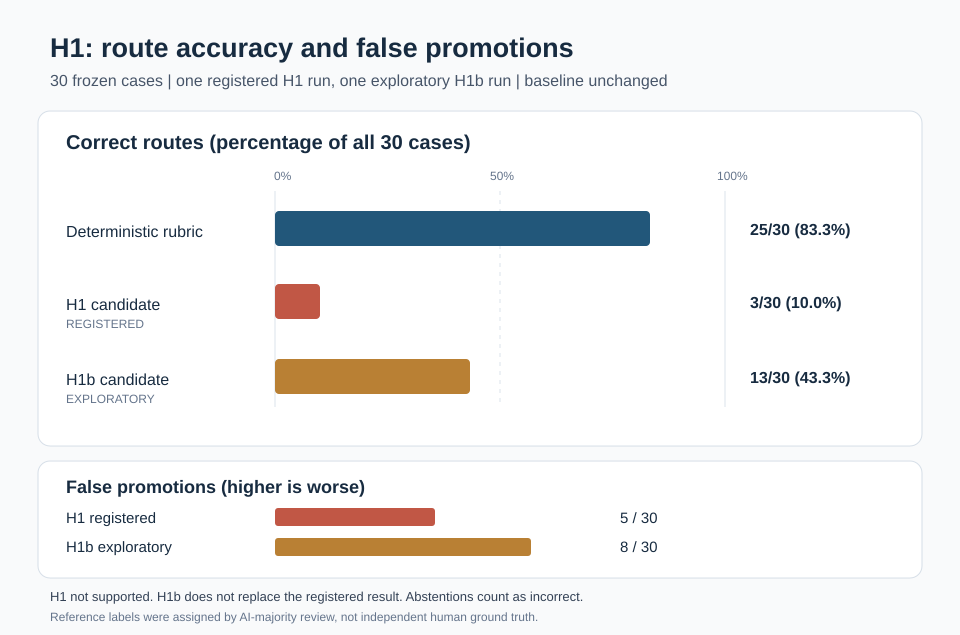

# Reproducing the H1 result figure



This is a **descriptive** figure produced from committed, frozen records. No
model run, relabeling, tuning or second registered test was performed to make
it. The **registered H1 verdict remains not supported**.

## Inputs and exact values

| Source | SHA-256 of committed run record | Correct / 30 | False promotions |
|---|---|---:|---:|
| Deterministic rubric | same baseline in both records | 25 / 30 (83.3%) | Not a candidate metric |
| Registered H1 candidate | `9d06bed917dbea2e1d83e29856b820d68c9c9c5cd1f3967363f3f112148b8b3d` | 3 / 30 (10.0%) | 5 |
| H1b candidate, **exploratory** | `e3b4dda4a674407025b7eb06380317578e89ec9a79aa4c868fa4dcfde62e0e9b` | 13 / 30 (43.3%) | 8 |

Both runs reference exactly the same `final-cases-v2.jsonl` case-file
SHA-256:
`f52e8f309733e78b56d1ac0ba354ff1c178bbf15912a196ef4038e3f93e0b396`.

The script cross-checks every plotted number against the individual case
rows, the record summaries, the case-file hash, unique case IDs and the
unchanged reference label and rubric prediction for each case. It refuses a
changed source record or a changed template. The archived primary H1 record
is confirmatory; H1b reused the already-known cases and is **not** an
independent test or a second attempt at H1's preregistered decision rule.

Accuracy is computed over **all 30 cases**, so an abstention is a miss. False
promotions count predictions above the assigned reference level (same rank
rule as `scripts/h1_result.py`). The rubric had 25 correct classifications
and appears only once because it was unchanged between H1 and H1b.

Reference labels came from a majority of three AI reviewers with owner
checks, **not from independent human ground truth**. The original H1 prompt
named the five routes without defining them. The exploratory H1b prompt
provided the route definitions. No inference about model identity, a new
population or a causal improvement follows from these one-run comparisons.

For the paired bootstrap intervals on the **accuracy gain against the
rubric**, see `scripts/h1_result.py` and
`docs/PREREGISTRATION.md` (registered H1: -0.733, 95% CI
[-0.867, -0.567]) and `h1b-interval.txt` (exploratory H1b: -0.400,
95% CI [-0.600, -0.200]). The SVG intentionally displays raw descriptive
accuracy and false-promotion counts, not intervals for an unmeasured
between-condition effect.

## Reproduction

From the repository root:

```sh
uv run python scripts/h1_figure.py --check
uv run python scripts/h1_figure.py --out evals/h1_review/h1-results.svg
uv run python -m pytest tests/test_h1_figure.py -q
```

`--check` changes nothing and fails if the checked-in SVG differs from
what the immutable run files and template produce. `--out` rewrites only
the specified output SVG. No network, model server, OSF connection, or
inference runtime is used. The SVG template is
`h1-results-template.svg`; the generated figure is `h1-results.svg`.

Use this caption when reporting:

> Descriptive accuracy on 30 frozen, AI-majority-labeled cases. The
> deterministic rubric classified 25 correctly, the registered H1 candidate
> 3, and the exploratory H1b candidate 13. False promotions were 5 for H1
> and 8 for H1b. H1 is not supported; H1b does not modify its verdict.
